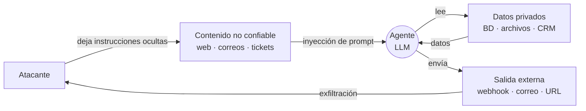
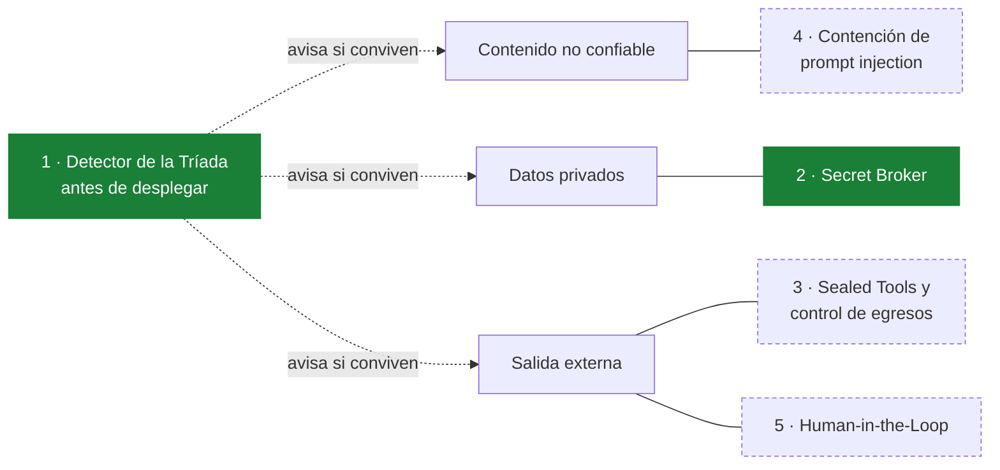
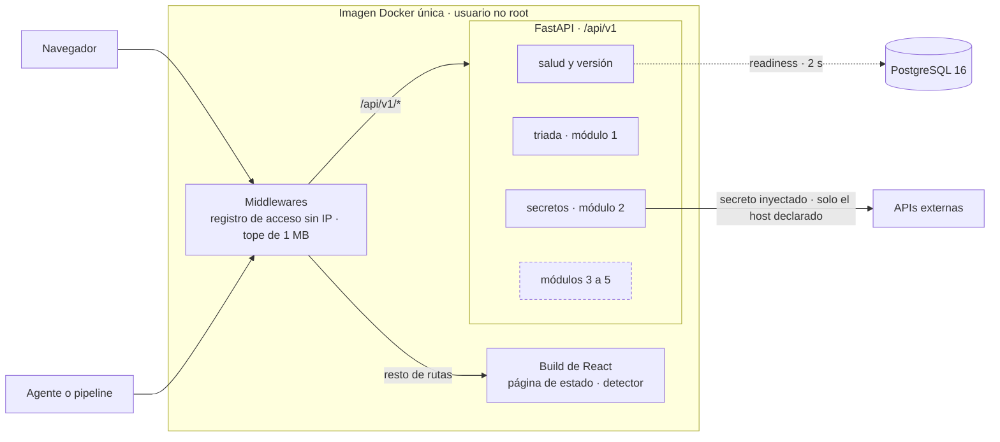
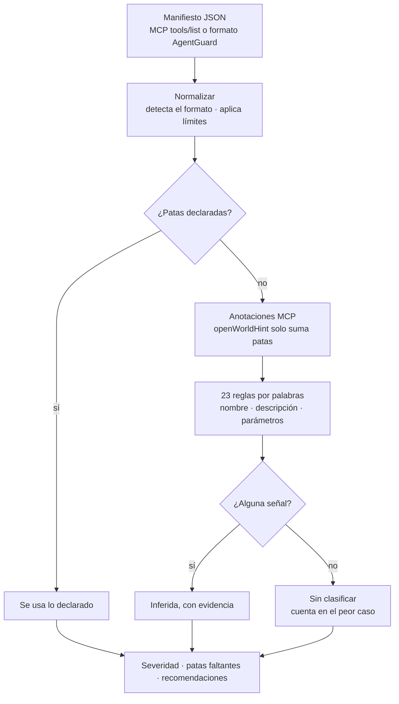
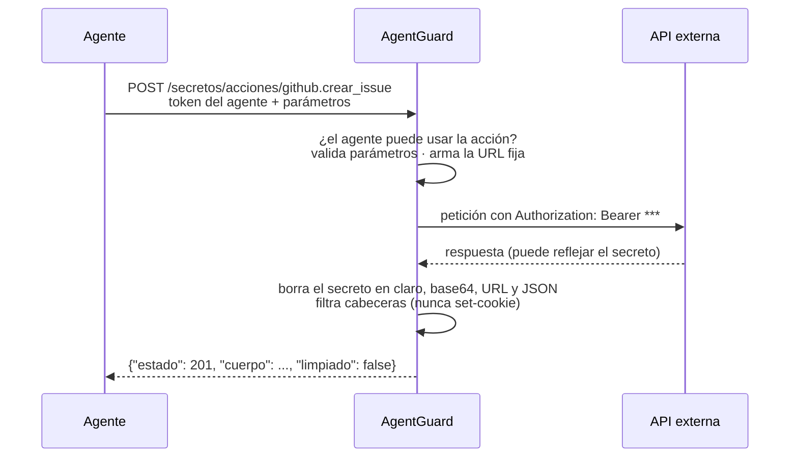
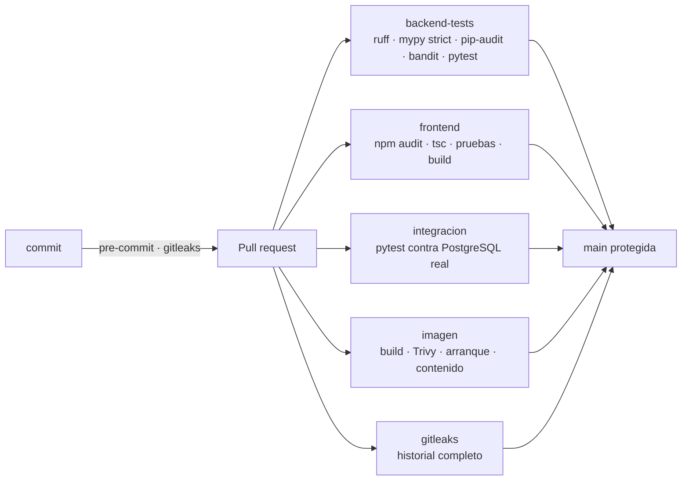

# AgentGuard

Proxy/middleware de seguridad que **protege agentes de IA en tiempo de ejecución**, con enfoque
Zero Trust y alineado con el [Secure AI Framework (SAIF)](https://safety.google/cybersecurity-advancements/saif/).

Con los agentes, la superficie de ataque crece: ya no basta con proteger datos, nube, API e
infraestructura, porque el propio modelo puede ser manipulado por lo que lee y usar sus herramientas
en contra de quien lo despliega.

**Índice:** [El problema](#el-problema-la-tríada-letal) · [Módulos](#módulos) ·
[Arquitectura](#arquitectura) · [Detector de la Tríada](#módulo-1-detector-de-la-tríada-letal) ·
[Secret Broker](#módulo-2-secret-broker) ·
[Puesta en marcha](#puesta-en-marcha) · [Calidad](#calidad-y-ci) · [Estructura](#estructura)

## El problema: la Tríada Letal

Un agente que a la vez **lee datos privados**, **ingiere contenido no confiable** y tiene **salida
externa** puede ser llevado por una inyección de prompt a exfiltrar esos datos. No hace falta
vulnerar ningún servidor: basta con que el agente lea un texto escrito por el atacante.



AgentGuard rompe la tríada en cada punto en vez de confiar en que el modelo se porte bien.

## Módulos

| # | Módulo | Qué hace | Estado |
|---|---|---|---|
| 1 | **Detector de la Tríada Letal** | Revisa el manifiesto de herramientas de un agente y alerta si reúne las tres condiciones. | ✅ Disponible |
| 2 | **Secret Broker** | Inyecta las credenciales al ejecutar la acción; el modelo nunca ve el secreto. | ✅ Disponible |
| 3 | **Sealed Tools y control de egresos (DLP)** | Herramientas acotadas y bloqueo (403) de cualquier destino fuera de la allowlist. | Pendiente |
| 4 | **Contención de prompt injection** | Inspección en cada salto (sesión, memoria, agente a agente) y ejecución aislada. | Pendiente |
| 5 | **Human-in-the-Loop Gate** | Aprobación explícita antes de toda acción irreversible. | Pendiente |

Dónde actúa cada módulo sobre la tríada:



## Arquitectura

Un **monolito**: un solo repo, un solo proceso y una sola imagen Docker. FastAPI expone la API en
`/api/v1` y sirve el build de React en el resto de las rutas. Cada módulo es un paquete propio
dentro de `backend/app/` que solo expone su interfaz pública, así que separarlo en un servicio más
adelante no exige rehacerlo.



| Endpoint | Qué responde |
|---|---|
| `GET /api/v1/health` | `200` mientras el proceso viva, aunque la base esté caída (liveness). |
| `GET /api/v1/health/dependencias` | `200` si PostgreSQL responde, `503` si no responde en 2 s (readiness). |
| `GET /api/v1/version` | Versión de la app. |
| `POST /api/v1/triada/analisis` | Reporte del Detector de la Tríada Letal. |
| `POST /api/v1/secretos/acciones/{accion}` | Ejecuta una acción del Secret Broker (token de agente). |
| `GET /api/v1/secretos/estado` | Acciones, agentes y secretos cargados, sin valores (token de administración). |

Los errores tienen formato fijo `{"detail": ...}`: `422` entrada inválida (sin repetir el valor
recibido), `413` cuerpo de más de 1 MB, `503` dependencia caída (reintentable) y `500` con un
`id_error` para ubicarlo en el log, sin traza en la respuesta.

## Módulo 1: Detector de la Tríada Letal

Recibe el manifiesto de herramientas de un agente y dice si reúne la tríada, **qué herramienta
aporta cada pata y por qué**. Acepta la respuesta de `tools/list` de un servidor
[MCP](https://modelcontextprotocol.io) tal cual, o un formato propio donde se pueden declarar las
patas y la allowlist de salida. Es determinista y **no usa IA**: un clasificador con LLM sería
atacable con la misma inyección que se busca detectar.



| Patas presentes | Severidad |
|---|---|
| Las tres, con alguna salida sin restringir | **crítica** |
| Las tres, con toda la salida en una allowlist | **alta** |
| Dos | **media** (indica cuál falta) |
| Una / ninguna | **baja** / **ninguna** |

Si hay herramientas que no se pudieron clasificar, el reporte se marca como **incompleto** y muestra
además la severidad del **peor caso**: una herramienta desconocida nunca se asume inofensiva.

**Ejemplo** (salida real, recortada):

```bash
curl -s -X POST http://localhost:8000/api/v1/triada/analisis \
  -H "Content-Type: application/json" \
  -d '{"tools": [
        {"name": "read_inbox", "description": "Lists the latest emails in the user inbox"},
        {"name": "fetch", "description": "Fetches a URL from the internet",
         "inputSchema": {"properties": {"url": {"type": "string"}}}}
      ]}'
```

```json
{
  "severidad": "critica",
  "incompleto": false,
  "faltan": [],
  "patas": {
    "datos_privados": [{"herramienta": "read_inbox", "origen": "regla", "regla": "P-CORREO", "fragmento": "inbox"}],
    "no_confiable":   [{"herramienta": "fetch", "origen": "regla", "regla": "U-WEB", "fragmento": "internet"}, "..."],
    "salida_externa": [{"herramienta": "fetch", "origen": "regla", "regla": "E-URL", "fragmento": "url"}]
  },
  "recomendaciones": [
    {"id": "R-SEPARAR-AGENTE", "texto": "Separa el agente: el que lee contenido no confiable no debe tener a la vez acceso a datos privados y una salida externa."},
    {"id": "R-ALLOWLIST", "texto": "Restringe las herramientas de salida a una allowlist de dominios (módulo 3: Sealed Tools y control de egresos)."},
    "..."
  ]
}
```

`fetch` con un parámetro `url` cubre dos patas a la vez: trae contenido que controla el atacante y la
URL que pide puede llevar datos afuera. El reporte lo destaca. También hay una pantalla en
`/modulos/triada` para pegar o cargar el manifiesto.

## Módulo 2: Secret Broker

El agente pide una acción por su nombre (`github.crear_issue`) con sus parámetros, y AgentGuard la
ejecuta con la credencial inyectada. **El modelo nunca ve la credencial**: no está en el prompt, ni
en el código que escribe, ni en la respuesta que recibe.



- **Mínimo privilegio:** cada agente tiene su token y solo sus acciones; `401`, `403` (exista o no
  la acción) y un límite de peticiones por minuto (`429`).
- **El modelo no desvía la petición:** esquema, host y método son fijos; los parámetros van
  codificados en huecos declarados y la URL final se verifica antes de salir. Solo `https`, sin
  seguir redirecciones y sin usar proxies del entorno.
- **Configuración versionada:** las acciones y los permisos viven en un JSON que pasa por PR
  ([ejemplo](config/acciones.ejemplo.json)); los secretos y tokens, en variables de entorno
  (`AGENTGUARD_SECRETO_<NOMBRE>`, `AGENTGUARD_AGENTE_<ID>`, `AGENTGUARD_ADMIN_TOKEN`), que se
  retiran del entorno al leerlas.
- **Si AgentGuard cae, el daño es acotado:** sin *core dumps*, proceso no *dumpable* (otro proceso no
  lee su memoria ni su entorno), sistema de archivos de solo lectura y sin *capabilities*.

Pantalla de estado en `/modulos/secretos` (pide el token de administración; nunca muestra valores).

## Puesta en marcha

Con Docker:

```bash
cp .env.example .env
docker compose up --build        # http://localhost:8000
```

Si el puerto 8000 o el 5434 están ocupados, cambia `APP_PUERTO` o `POSTGRES_PUERTO` en el `.env`.

Para desarrollar (Python 3.12 y Node 24):

```bash
# backend
cd backend
python -m venv .venv
.venv/Scripts/pip install -r requirements-dev.txt    # Linux/macOS: .venv/bin/pip
uvicorn app.main:crear_app --factory --reload --no-access-log

# frontend (Vite reenvía /api a localhost:8000)
cd frontend
npm ci && npm run dev
```

## Calidad y CI

Cada cambio entra a `main` por un pull request, y `main` está protegida: solo se integra con las
cinco verificaciones en verde y la rama al día.



Cada funcionalidad parte de una especificación con historias, criterios de aceptación y decisiones:
ver [`docs/specs/`](docs/specs/). Las pruebas se nombran por el criterio que cubren
(`test_spec0002_e12_sin_clasificar_marca_incompleto_y_peor_caso`).

## Estructura

```
backend/
  app/
    main.py          crear_app(): monta los routers y el frontend
    core/            configuración, errores, salud, registro, tope, archivos estáticos
    base/            pool de PostgreSQL (único que importa asyncpg)
    triada/          módulo 1: normalizar · reglas · clasificar · análisis · rutas
    secretos/        módulo 2: config · fuentes · identidad · petición · ejecutor · limpieza
  tests/             unitarias con dobles; integración marcada `integracion`
frontend/src/        React + TypeScript: página de estado y pantallas de los módulos
config/              ejemplo de acciones del Secret Broker
docs/specs/          especificación, plan y tareas de cada funcionalidad
Dockerfile           imagen única (Node construye, Python sirve)
docker-compose.yml   app + PostgreSQL local
```
